---

# 🚗 Sistema de Aluguel de Carros 👨‍💻

> [!NOTE]
> Aplicação web para **registrar, acompanhar e avaliar pedidos de aluguel de automóveis**: o cliente faz o pedido e acompanha o status; agentes (empresas e bancos) avaliam financeiramente e executam o contrato, com ou sem crédito bancário.

<table>
  <tr>
    <td width="800px">
      <div align="justify">
        Trabalho do <b>Laboratório 02</b> da disciplina de <b>Desenvolvimento e Integração de Aplicações Web (DIAW)</b>, Engenharia de Software, PUC Minas. O projeto segue a arquitetura <b>MVC</b> e é dividido em um <b>back-end Spring Boot</b> (API REST com autenticação JWT), um <b>front-end React + Vite</b> e um banco <b>PostgreSQL no Supabase</b>. Os modelos UML (casos de uso, histórias de usuário, classes e pacotes) ficam em <a href="./docs">docs/</a> e foram escritos junto com o código, para que um reflita o outro.
      </div>
    </td>
    <td>
      <div>
        
      </div>
    </td>
  </tr>
</table>

---

## 🚧 Status do Projeto


| Item | Situação |
|------|----------|
| Autenticação (usuário e senha, JWT) | ✅ |
| CRUD de cliente | ✅ |
| Pedidos de aluguel (introduzir, modificar, consultar, cancelar) | ✅ |
| Avaliação financeira e execução do contrato (com crédito opcional) | ✅ |
| Protótipo: criar pedido e ver o status | ✅ |
| Diagramas UML e histórias de usuário | ✅ |
| Notificação por e-mail ao cliente quando o status muda | 🔜 planejado (HU15) |

---

## 📚 Índice
- [Links Úteis](#-links-úteis)
- [Sobre o Projeto](#-sobre-o-projeto)
- [Funcionalidades Principais](#-funcionalidades-principais)
- [Tecnologias Utilizadas](#-tecnologias-utilizadas)
- [Arquitetura](#-arquitetura)
- [Instalação e Execução](#-instalação-e-execução)
  - [Pré-requisitos](#pré-requisitos)
  - [Variáveis de Ambiente](#-variáveis-de-ambiente)
  - [Inicialização do Banco de Dados (Supabase)](#-inicialização-do-banco-de-dados-supabase)
  - [Instalação de Dependências](#-instalação-de-dependências)
  - [Como Executar a Aplicação](#-como-executar-a-aplicação)
- [Deploy](#-deploy)
- [Estrutura de Pastas](#-estrutura-de-pastas)
- [Demonstração](#-demonstração)
- [Testes](#-testes)
- [Documentações utilizadas](#-documentações-utilizadas)
- [Autores](#-autores)
- [Contribuição](#-contribuição)
- [Agradecimentos](#-agradecimentos)
- [Licença](#-licença)

---

## 🔗 Links Úteis
* 📖 **Histórias de usuário:** [docs/01-historias-de-usuario.md](./docs/01-historias-de-usuario.md)
* 🧩 **Casos de uso:** [docs/02-casos-de-uso.md](./docs/02-casos-de-uso.md)
* 🏛️ **Diagrama de classes:** [docs/03-diagrama-de-classes.md](./docs/03-diagrama-de-classes.md)
* 📦 **Diagrama de pacotes:** [docs/04-diagrama-de-pacotes.md](./docs/04-diagrama-de-pacotes.md)
* 💾 **Script do banco:** [database/schema.sql](./database/schema.sql)

---

## 📝 Sobre o Projeto

Locadoras precisam saber **quem está alugando o quê, por quanto tempo e se o cliente tem condições financeiras de fechar o contrato**. Sem um fluxo único, isso se perde em planilhas e mensagens. Este sistema resolve o ciclo completo:

1. O **cliente** (com RG, CPF, nome, endereço, profissão e até 3 rendimentos) cria um pedido de aluguel para um automóvel e um período.
2. Um **agente** (empresa ou banco) faz a **análise financeira** e aprova ou reprova, registrando o parecer.
3. Pedidos aprovados viram **contrato**. O contrato define em nome de quem o automóvel fica registrado (**cliente, empresa ou banco**) e pode vir acompanhado de um **crédito concedido por um banco**.
4. O cliente acompanha o status o tempo todo e pode **modificar** ou **cancelar** o pedido enquanto ele ainda não foi concluído.

O contexto é acadêmico, mas as regras de negócio são as de um sistema real: ninguém acessa nada sem login, um cliente só enxerga os próprios pedidos e o mesmo carro não pode ser reservado duas vezes no mesmo período.

### Atendimento ao enunciado

| Pedido no enunciado | Onde está |
|---------------------|-----------|
| Diagrama de casos de uso | [docs/02-casos-de-uso.md](./docs/02-casos-de-uso.md) |
| Histórias de usuário | [docs/01-historias-de-usuario.md](./docs/01-historias-de-usuario.md) |
| Diagrama de classes | [docs/03-diagrama-de-classes.md](./docs/03-diagrama-de-classes.md) |
| Diagrama de pacotes | [docs/04-diagrama-de-pacotes.md](./docs/04-diagrama-de-pacotes.md) |
| Autenticação (usuário e senha) | `AuthController`, `AuthService`, `security/`, telas de login e cadastro |
| CRUD de cliente | `ClienteController`, `ClienteService`, telas "Meu cadastro" e "Clientes" |
| Protótipo (criar pedido e ver status) | telas "Novo pedido", "Meus pedidos" e "Detalhe do pedido" |
| Revisão dos diagramas | classes, estados e pacotes conferidos contra o código final; as regras estão em "Regras de negócio" abaixo |
| MVC | `model`, `repository`/`service`/`controller` no back-end; `pages`/`components`/`services` no front-end |

---

## ✨ Funcionalidades Principais

- 🔐 **Login obrigatório:** nada além de login e cadastro é público. Senhas com BCrypt e sessão por token JWT.
- 👤 **CRUD de cliente:** cadastro com validação de CPF, até 3 rendimentos (entidade empregadora e valor), consulta, alteração e exclusão.
- 📝 **Pedidos de aluguel:** introduzir, modificar (somente em análise), consultar e cancelar.
- 🔎 **Acompanhamento de status:** linha do tempo *Em análise → Aprovado → Contratado*, mais *Reprovado* e *Cancelado*.
- 🏦 **Avaliação financeira:** o agente aprova ou reprova com parecer.
- 📄 **Contrato com crédito opcional:** proprietário do automóvel (cliente, empresa ou banco) e crédito concedido por um banco.
- 🚘 **Catálogo de automóveis:** matrícula, ano, marca, modelo e placa; agentes cadastram novos.
- 🛡️ **Controle de acesso por perfil:** `CLIENTE` e `AGENTE`, no back-end (`@PreAuthorize`) e no front-end (rotas protegidas).

### Regras de negócio

- O cliente tem **no máximo 3 rendimentos** (validado na aplicação e por trigger no banco).
- CPF válido e único; login único.
- Transições de status permitidas: `EM_ANALISE → APROVADO`, `EM_ANALISE → REPROVADO`, `EM_ANALISE/APROVADO → CANCELADO`, `APROVADO → CONTRATADO`.
- Só pedidos **em análise** podem ser modificados; reprovar exige parecer.
- Um automóvel não pode ter dois pedidos ativos (em análise, aprovados ou contratados) em períodos que se sobreponham.
- O crédito só pode ser concedido por um agente do tipo **banco**, e banco e valor andam juntos.
- Ao executar o contrato, o automóvel passa para o proprietário informado.
- Um cliente com pedidos ativos não pode ser excluído. Um cliente que acessa o pedido de outro recebe `404`.

---

## 🛠 Tecnologias Utilizadas

### 💻 Front-end
- **React 19** e **React Router 7**
- **Vite 8**
- **Oxlint** (lint)
- CSS próprio, com tema claro e escuro

### 🖥️ Back-end
- **Java 25** e **Spring Boot 4.0.x** (Spring MVC)
- **Spring Data JPA / Hibernate**
- **Spring Security** (stateless) com **JWT** (JJWT 0.12.6) e **BCrypt**
- **Bean Validation**, com validador de CPF próprio
- **JUnit 5** e **Mockito** para testes
- **Maven**

### ⚙️ Infraestrutura
- **Supabase** (PostgreSQL) com Row Level Security ligado em todas as tabelas
- **Mermaid** para os diagramas UML

---

## 🏗 Arquitetura

O sistema segue **MVC**, com o back-end em camadas e o front-end consumindo a API REST:

| Camada MVC | Back-end (Spring Boot) | Front-end (React) |
|-----------|------------------------|-------------------|
| **Model** | `model/` (entidades JPA), `repository/` | `services/api.js` e estado dos contextos |
| **View** | respostas JSON (`dto/`) | `pages/` e `components/` |
| **Controller** | `controller/` (REST) e `service/` (regras de negócio) | `context/AuthContext`, handlers das páginas |

Os diagramas completos estão em [`docs/`](./docs):

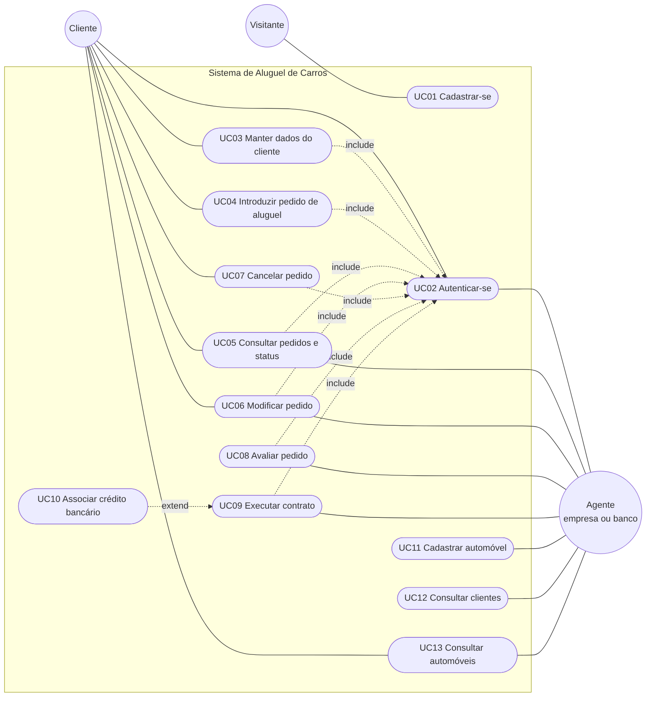

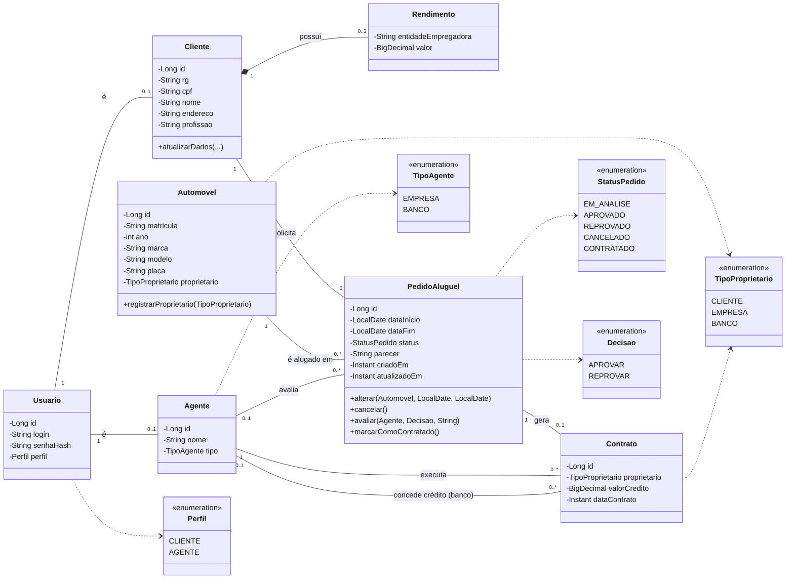

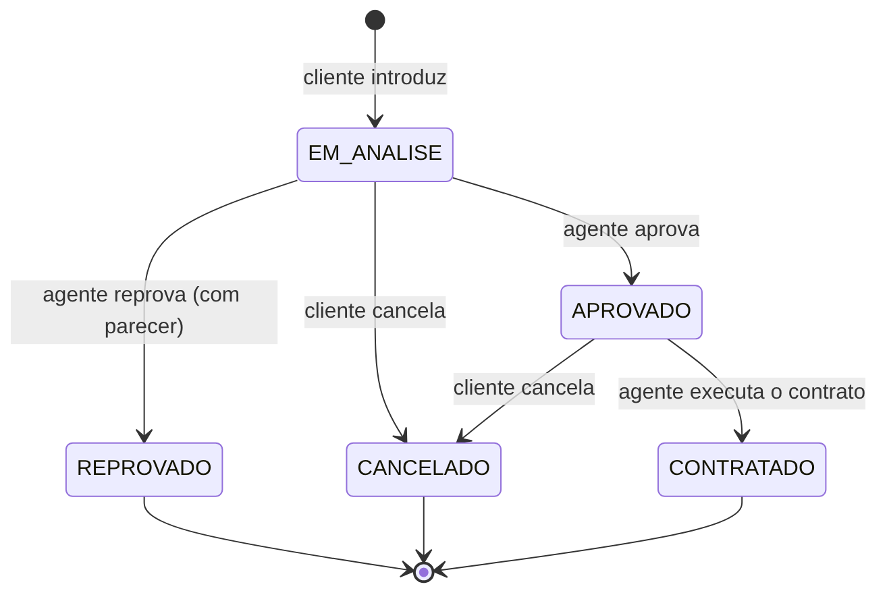

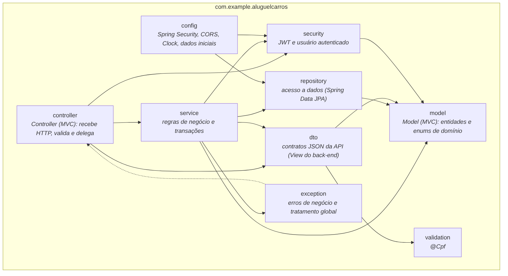

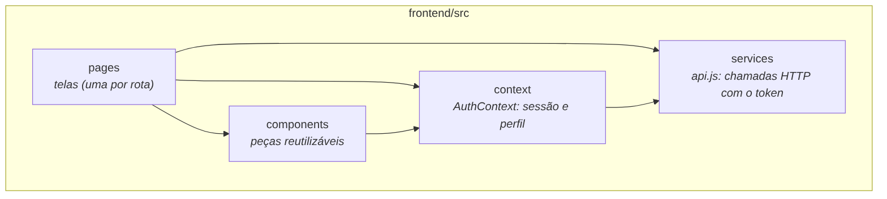

### API REST

Todas as rotas, exceto `/api/auth/**`, exigem o cabeçalho `Authorization: Bearer <token>`.

| Método | Rota | Quem acessa | Descrição |
|--------|------|-------------|-----------|
| POST | `/api/auth/registro` | público | Cadastro de cliente (credenciais + dados) e login automático |
| POST | `/api/auth/login` | público | Devolve o token JWT |
| GET | `/api/clientes/me` | cliente | Cadastro do próprio cliente |
| GET | `/api/clientes` | agente | Lista de clientes |
| GET/PUT/DELETE | `/api/clientes/{id}` | cliente (o próprio) ou agente | Consultar, alterar e excluir |
| GET | `/api/automoveis` | autenticado | Lista de automóveis |
| POST | `/api/automoveis` | agente | Cadastra automóvel |
| GET | `/api/agentes?tipo=BANCO` | agente | Lista de agentes (usada para escolher o banco do crédito) |
| POST | `/api/pedidos` | cliente | Introduz um pedido |
| GET | `/api/pedidos?status=` | autenticado | Cliente vê os seus; agente vê todos |
| GET/PUT | `/api/pedidos/{id}` | dono ou agente | Consultar e modificar (só em análise) |
| POST | `/api/pedidos/{id}/cancelamento` | cliente | Cancela o pedido |
| POST | `/api/pedidos/{id}/avaliacao` | agente | `{ "decisao": "APROVAR" \| "REPROVAR", "parecer": "..." }` |
| POST | `/api/pedidos/{id}/contrato` | agente | `{ "proprietario", "bancoCreditoId?", "valorCredito?" }` |

Erros seguem um formato único: `{ "status", "mensagem", "campos": { "campo": "motivo" } }`.

---

## 🔧 Instalação e Execução

### Pré-requisitos
- **JDK 25** e **Maven 3.9+**
- **Node.js 20.19+** (ou 22.12+) e **npm**
- Um projeto no **Supabase** (plano gratuito basta)
- **Git**

### 🔑 Variáveis de Ambiente

#### 1 Back-end (Spring Boot)

Há um modelo em [`backend/.env.example`](./backend/.env.example). O Spring lê as variáveis do ambiente, então exporte-as no terminal ou cadastre-as na configuração de execução da IDE.

| Variável | Obrigatória | Padrão | Descrição |
|----------|:-----------:|--------|-----------|
| `DB_URL` | ✅ | — | URL JDBC do Supabase (`jdbc:postgresql://...:5432/postgres?sslmode=require`) |
| `DB_USER` | ✅ | — | Usuário do banco (no pooler: `postgres.<ref-do-projeto>`) |
| `DB_PASSWORD` | ✅ | — | Senha do banco |
| `JWT_SECRET` | ✅ | — | Segredo de assinatura, **mínimo de 32 caracteres**. Gere com `openssl rand -base64 48` |
| `JWT_EXPIRACAO_MINUTOS` | | `120` | Validade do token |
| `CORS_ALLOWED_ORIGINS` | | `http://localhost:5173` | Origens do front-end, separadas por vírgula |
| `DDL_AUTO` | | `update` | `update` cria o que faltar; `validate` só confere o esquema |
| `SEED_ENABLED` | | `true` | Cria dados iniciais (agentes e automóveis) |
| `SEED_SENHA_AGENTES` | | vazio | Senha dos agentes de demonstração. **Se vazia, os agentes não são criados** |
| `PORT` | | `8080` | Porta da API |

> [!IMPORTANT]
> O `JWT_SECRET` não tem valor padrão de propósito: a aplicação não sobe sem ele. Nunca envie segredos ao GitHub; o `.gitignore` já ignora arquivos `.env`.

#### 2 Front-end (React, Vite)

| Variável | Padrão | Descrição |
|----------|--------|-----------|
| `VITE_API_URL` | `http://localhost:8080` | URL base da API. Modelo em [`frontend/.env.example`](./frontend/.env.example) |

### 💾 Inicialização do Banco de Dados (Supabase)

1. No Supabase, crie um projeto e, em **Project Settings → Database**, copie a *connection string* para montar `DB_URL`, `DB_USER` e `DB_PASSWORD`.
2. Abra o **SQL Editor**, cole o conteúdo de [`database/schema.sql`](./database/schema.sql) e execute. Ele cria as tabelas, restrições, índices, o trigger do limite de 3 rendimentos e liga o **Row Level Security** em todas as tabelas. Como o acesso aos dados é feito só pelo back-end (JDBC), a chave pública do Supabase não consegue ler nada.
3. Opcional: com o esquema criado, use `DDL_AUTO=validate`. Se preferir, deixe `DDL_AUTO=update` e o Hibernate cria as tabelas na primeira execução.

### 📦 Instalação de Dependências

```bash
# clonar
git clone <url-do-repositorio>
cd <pasta-do-repositorio>

# front-end
cd frontend
npm install

# back-end (baixa as dependências e compila)
cd ../backend
mvn clean install -DskipTests
```

### ⚡ Como Executar a Aplicação

#### Terminal 1: Back-end (Spring Boot)

```bash
cd backend

export DB_URL='jdbc:postgresql://<host>:5432/postgres?sslmode=require'
export DB_USER='postgres.<ref-do-projeto>'
export DB_PASSWORD='<senha>'
export JWT_SECRET="$(openssl rand -base64 48)"
export SEED_SENHA_AGENTES='<senha-dos-agentes>'

mvn spring-boot:run
```

A API sobe em `http://localhost:8080`. Na primeira execução são criados os agentes de demonstração (`agente.empresa`, da *Locadora Estrada Livre*, e `agente.banco`, do *Banco Horizonte*, ambos com a senha de `SEED_SENHA_AGENTES`) e cinco automóveis.

> [!TIP]
> Em produção, use `SEED_ENABLED=false`. Agentes não têm cadastro público: eles só passam a existir pelo seed ou direto no banco.

#### Terminal 2: Front-end (React, Vite)

```bash
cd frontend
cp .env.example .env     # ajuste VITE_API_URL se necessário
npm run dev
```

Acesse `http://localhost:5173`.

**Roteiro rápido para testar o fluxo completo**

1. Em **Cadastre-se**, crie um cliente.
2. Em **Novo pedido**, escolha um automóvel e um período.
3. Saia e entre como `agente.empresa`. Abra o pedido, **aprove** e, depois, **execute o contrato** (se quiser, marque o crédito e escolha o *Banco Horizonte*).
4. Entre de novo como o cliente: o pedido aparece como **Contratado**, com os dados do contrato.

---

## 🚀 Deploy

```bash
# Front-end: gera a pasta dist/ com arquivos estáticos
cd frontend
VITE_API_URL=https://<url-publica-da-api> npm run build

# Back-end: gera o JAR executável em target/
cd ../backend
mvn clean package
java -jar target/aluguel-carros-0.0.1-SNAPSHOT.jar
```

- O **front-end** (`dist/`) pode ser servido por qualquer hospedagem de arquivos estáticos (Vercel, Netlify, Nginx). Como é uma SPA, configure o *fallback* para `index.html`.
- O **back-end** roda em qualquer host com JDK 25 (Render, Railway, VPS). Defina as variáveis de ambiente da tabela acima, com `CORS_ALLOWED_ORIGINS` apontando para o endereço público do front-end e `SEED_ENABLED=false`.
- O banco é o próprio Supabase.

> [!NOTE]
> O token JWT fica no `localStorage` do navegador, escolha comum em SPAs de estudo. Em produção, vale considerar cookie `HttpOnly` e um tempo de expiração menor, porque o `localStorage` fica exposto a qualquer script injetado na página.

---

## 📂 Estrutura de Pastas

```text
.
├── backend/
│   ├── pom.xml
│   └── src/
│       ├── main/java/com/example/aluguelcarros/
│       │   ├── AluguelCarrosApplication.java
│       │   ├── model/         # entidades JPA e enums (Cliente, PedidoAluguel, Contrato...)
│       │   ├── repository/    # Spring Data JPA
│       │   ├── service/       # regras de negócio
│       │   ├── controller/    # endpoints REST
│       │   ├── dto/           # contratos de entrada e saída da API
│       │   ├── security/      # JWT e filtro de autenticação
│       │   ├── config/        # segurança, CORS, relógio, dados iniciais
│       │   ├── validation/    # @Cpf
│       │   └── exception/     # exceções de negócio e handler global
│       ├── main/resources/application.properties
│       └── test/java/...      # testes unitários
├── frontend/
│   └── src/
│       ├── pages/             # telas (Login, Pedidos, PedidoDetalhe...)
│       ├── components/        # Header, ClienteForm, StatusBadge...
│       ├── context/           # AuthContext
│       ├── services/api.js    # acesso à API
│       └── utils/             # formatadores e validação de CPF
├── database/schema.sql        # esquema PostgreSQL/Supabase
├── docs/                      # histórias de usuário e diagramas UML (+ imagens)
└── README.md
```

---

## 🎥 Demonstração

Capturas da interface com dados de exemplo.

| Cadastro | Novo pedido |
|:-:|:-:|
| 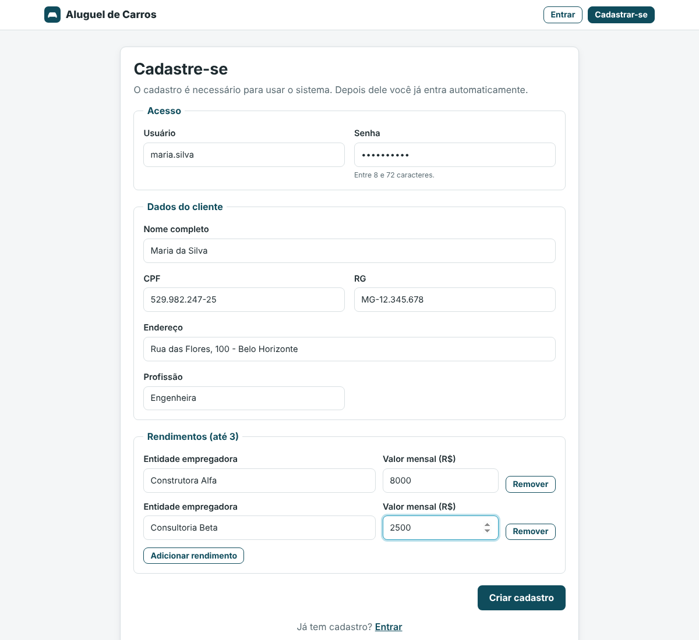 | 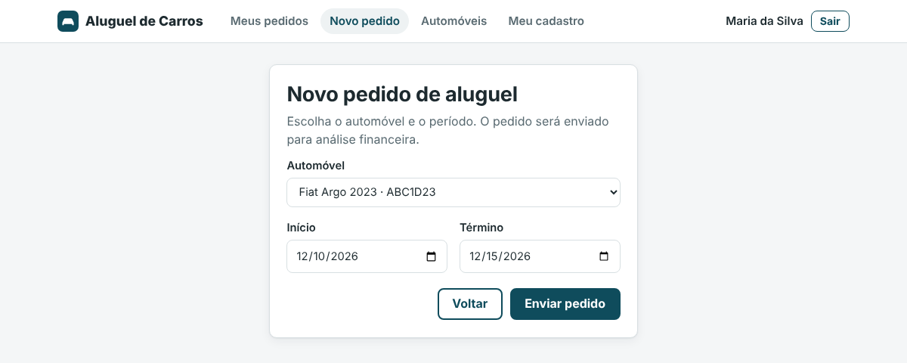 |

| Avaliação (agente) | Contrato (agente) |
|:-:|:-:|
| 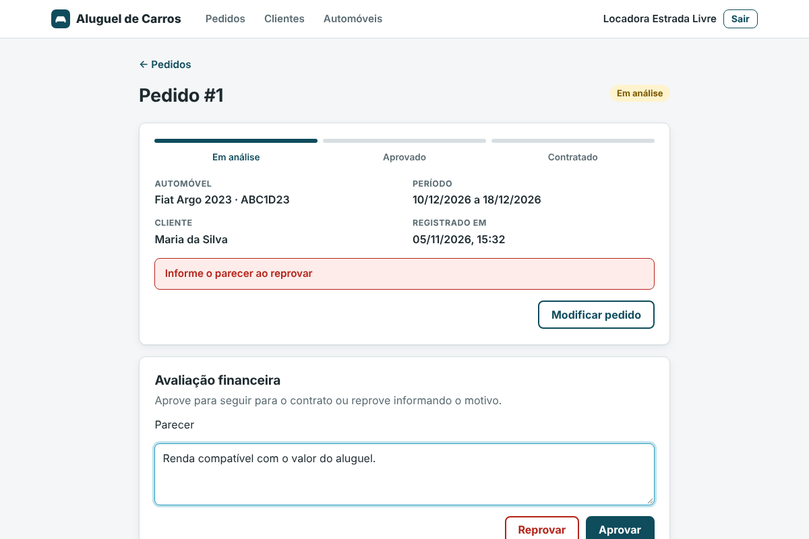 | 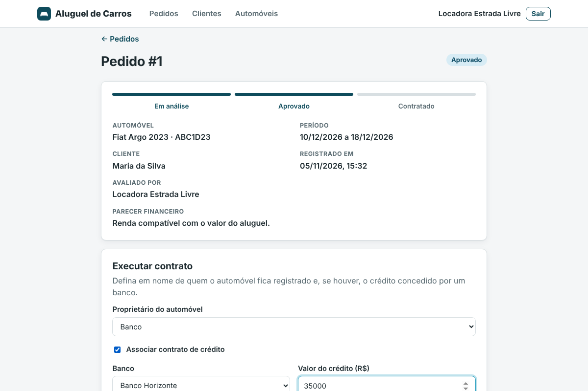 |

| Status do pedido (cliente) | Clientes (agente) |
|:-:|:-:|
| 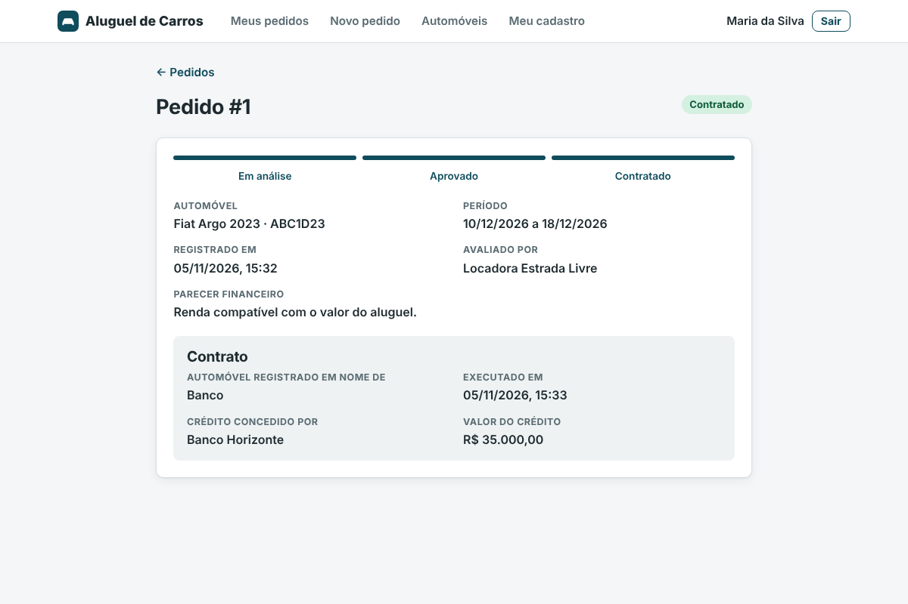 | 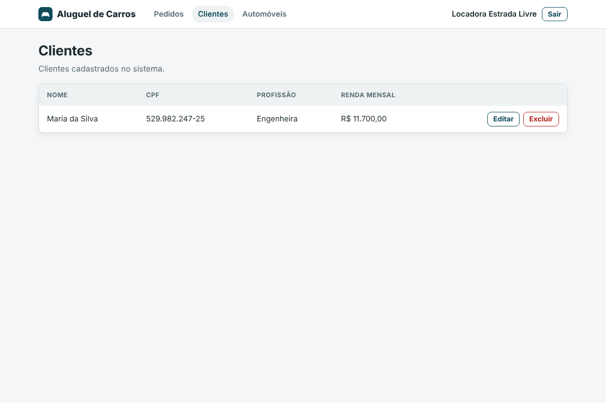 |

### 💻 Exemplo de uso da API

```bash
# login
curl -s -X POST http://localhost:8080/api/auth/login \
  -H 'Content-Type: application/json' \
  -d '{"login":"agente.empresa","senha":"<senha-dos-agentes>"}'
# => { "token": "eyJ...", "tipoToken": "Bearer", "login": "agente.empresa", "perfil": "AGENTE", ... }

# listar pedidos em análise
curl -s 'http://localhost:8080/api/pedidos?status=EM_ANALISE' \
  -H "Authorization: Bearer $TOKEN"

# aprovar o pedido 1
curl -s -X POST http://localhost:8080/api/pedidos/1/avaliacao \
  -H "Authorization: Bearer $TOKEN" -H 'Content-Type: application/json' \
  -d '{"decisao":"APROVAR","parecer":"Renda compatível com o aluguel."}'
```

---

## 🧪 Testes

### Testes Unitários

São 51 testes com JUnit 5 e Mockito, cobrindo o validador de CPF, a máquina de estados do pedido, as regras do cliente (limite de rendimentos), o `JwtService` e os serviços de pedido e cliente (conflito de período, permissões, crédito só por banco, exclusão bloqueada).

```bash
cd backend
mvn test
```

### Front-end

```bash
cd frontend
npm run lint
npm run build
```

---

## 🔗 Documentações utilizadas

* 📖 **Back-end:** [Spring Boot](https://docs.spring.io/spring-boot/index.html), [Spring Security](https://docs.spring.io/spring-security/reference/), [Spring Data JPA](https://docs.spring.io/spring-data/jpa/reference/)
* 📖 **JWT:** [JJWT](https://github.com/jwtk/jjwt)
* 📖 **Front-end:** [React](https://react.dev/reference/react), [React Router](https://reactrouter.com/), [Vite](https://vitejs.dev/config/)
* 📖 **Banco:** [Supabase Database](https://supabase.com/docs/guides/database/overview), [Row Level Security](https://supabase.com/docs/guides/database/postgres/row-level-security)
* 📖 **Diagramas:** [Mermaid](https://mermaid.js.org/)
* 📖 **Padrão de commits:** [Conventional Commits](https://www.conventionalcommits.org/en/v1.0.0/)

---

## 👥 Autores

| 👤 Nome | :octocat: GitHub |
|---------|-----------------|
| Guilherme Bittencourt | [@GuilhermePBittencourt](https://github.com/GuilhermePBittencourt) |

---

## 🤝 Contribuição

1. Faça um `fork` do projeto.
2. Crie uma branch (`git checkout -b feature/minha-feature`).
3. Faça o commit (`git commit -m 'feat: adiciona nova funcionalidade'`), seguindo [Conventional Commits](https://www.conventionalcommits.org/en/v1.0.0/).
4. Envie a branch (`git push origin feature/minha-feature`).
5. Abra um **Pull Request**.

---

## 🙏 Agradecimentos

* [**Engenharia de Software PUC Minas**](https://www.instagram.com/engsoftwarepucminas/), pelo apoio institucional e acadêmico.
* [**Prof. Dr. João Paulo Aramuni**](https://github.com/joaopauloaramuni), pelo enunciado, pelo template de README e pelos projetos Spring Boot usados como referência de organização em pacotes.

---

## 📄 Licença

Projeto acadêmico distribuído sob a **Licença MIT**.

---
