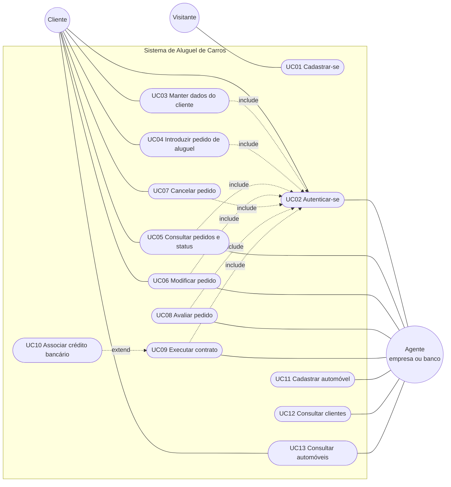

# Diagrama de Casos de Uso

O diagrama usa a sintaxe Mermaid (renderizada automaticamente pelo GitHub). Atores à esquerda e à direita,
casos de uso no centro. Todo caso de uso, exceto "Cadastrar-se" e "Autenticar-se", exige autenticação
(relação `include`).

## Descrição resumida

| Caso de uso | Ator | Fluxo principal | Regras |
|---|---|---|---|
| UC01 Cadastrar-se | Visitante | Informa usuário, senha e dados de cliente (até 3 rendimentos). | CPF válido e único; usuário único. |
| UC02 Autenticar-se | Cliente, Agente | Informa usuário e senha; recebe um token JWT. | Mensagem de erro única para credenciais inválidas. |
| UC03 Manter dados do cliente | Cliente (e agente, via lista de clientes) | Consulta, modifica ou exclui o cadastro. | Não exclui com pedido ativo. |
| UC04 Introduzir pedido | Cliente | Escolhe automóvel e período; o pedido entra em análise. | Período válido e automóvel livre. |
| UC05 Consultar pedidos | Cliente, Agente | Lista e detalha pedidos; agente filtra por status. | Cliente vê só os próprios. |
| UC06 Modificar pedido | Cliente, Agente | Altera automóvel ou período. | Somente em análise. |
| UC07 Cancelar pedido | Cliente | Cancela o próprio pedido. | Somente em análise ou aprovado. |
| UC08 Avaliar pedido | Agente | Aprova ou reprova com parecer financeiro. | Somente em análise; reprovar exige parecer. |
| UC09 Executar contrato | Agente | Transforma o pedido aprovado em contrato e define o proprietário do automóvel. | Somente pedido aprovado. |
| UC10 Associar crédito | Agente (banco) | Informa o banco e o valor do crédito ao executar o contrato. | Opcional; só banco concede crédito. |
| UC11 Cadastrar automóvel | Agente | Registra matrícula, ano, marca, modelo, placa e proprietário. | Placa e matrícula únicas. |
| UC12 Consultar clientes | Agente | Lista os clientes. | — |
| UC13 Consultar automóveis | Cliente, Agente | Lista o catálogo. | — |
