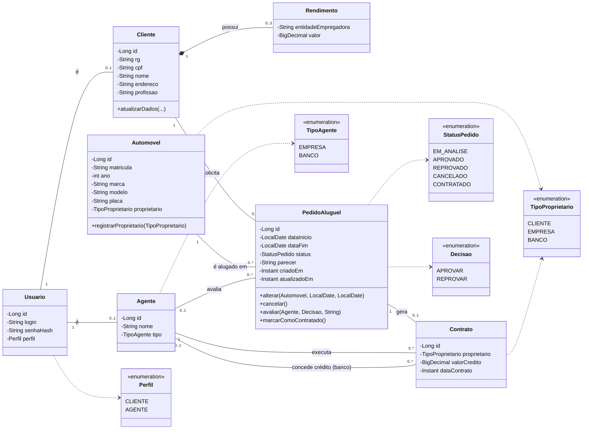
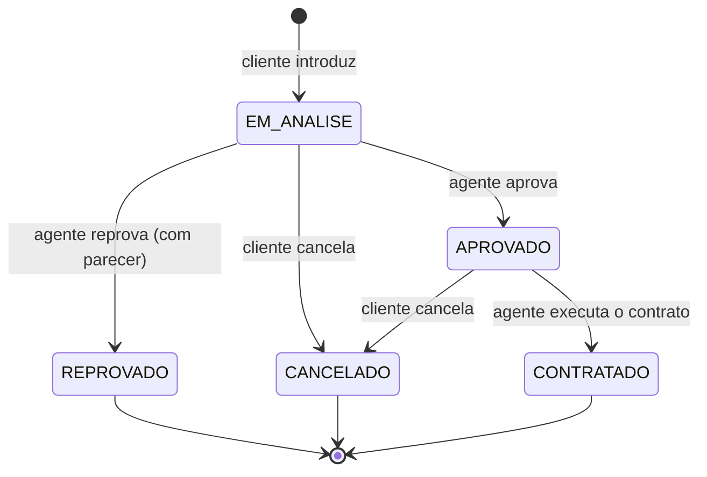

# Diagrama de Classes (domínio)

Reflete exatamente as entidades JPA do pacote `model` do back-end.

## Máquina de estados do pedido

## Decisões de modelagem

- **Usuario** guarda só as credenciais; **Cliente** e **Agente** são os papéis de negócio ligados a ele (1 para 0..1).
- Os **rendimentos** são um objeto de valor (`@Embeddable`) dentro do cliente, limitado a 3.
- Não existe uma classe separada para "empresa" e "banco": ambos são **Agente**, distinguidos por `TipoAgente`.
- O proprietário do automóvel (`TipoProprietario`) muda quando o **Contrato** é executado, pois, segundo o enunciado, depende do tipo de contrato.
- O crédito é opcional: `bancoCredito` e `valorCredito` do contrato são nulos ou preenchidos juntos.
