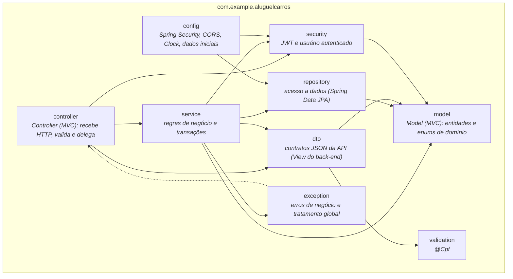
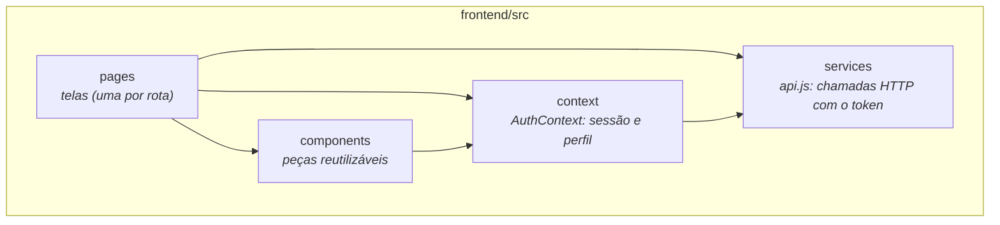

# Diagrama de Pacotes (Visão Lógica) e Arquitetura MVC

## Back-end (Spring Boot)

## Front-end (React + Vite)

## Como o MVC se distribui

| Camada MVC | Onde está |
|---|---|
| **Model** | `model` (entidades), `repository` (persistência) e `service` (regras) no back-end; Supabase (PostgreSQL) como armazenamento |
| **View** | React + Vite (`frontend/`), que renderiza as telas a partir do JSON da API |
| **Controller** | `controller` no back-end (REST), que traduz requisições HTTP em chamadas aos serviços |

## Os dois subsistemas do enunciado

1. **Gestão de pedidos e contratos**: `PedidoController`, `PedidoService`, `Contrato`, regras de status.
2. **Construção dinâmica das páginas web**: o front-end React monta as páginas dinamicamente a partir da API.

O servidor central (Spring Boot) se liga aos computadores locais dos clientes e aos agentes pela Internet
(HTTP/JSON), com CORS restrito às origens configuradas.
